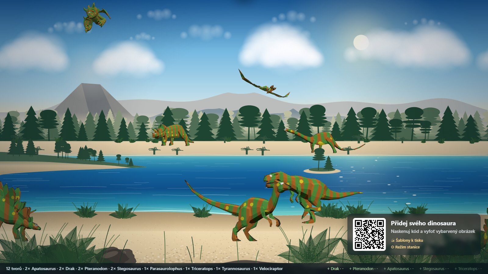
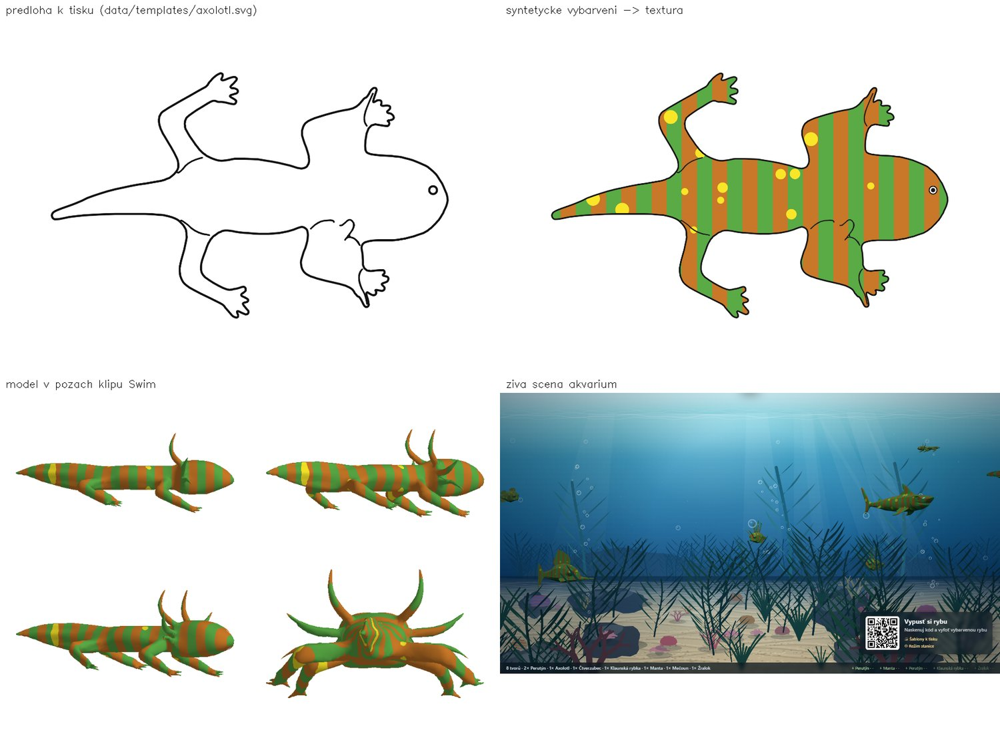
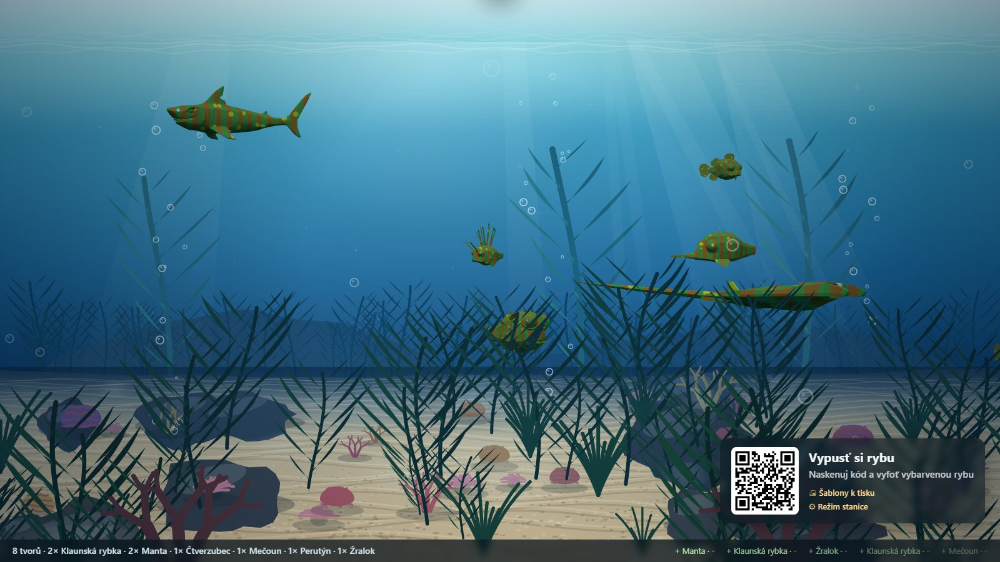
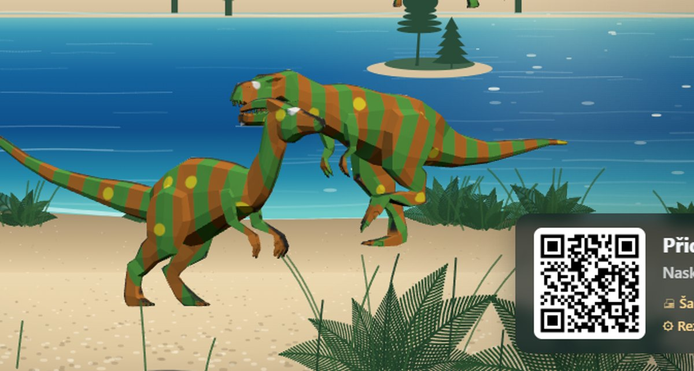
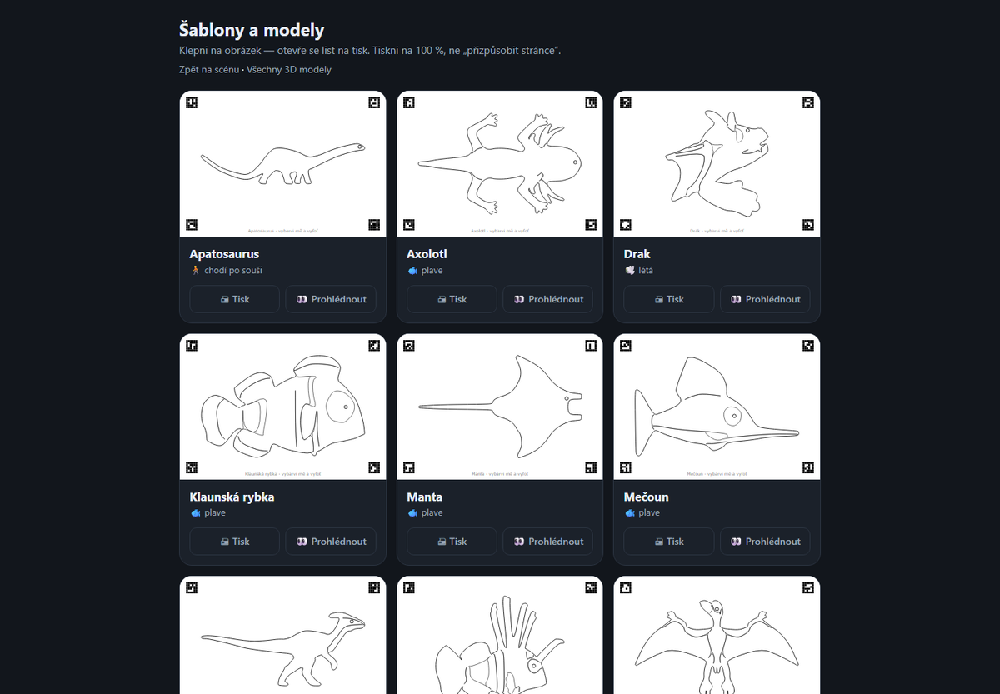
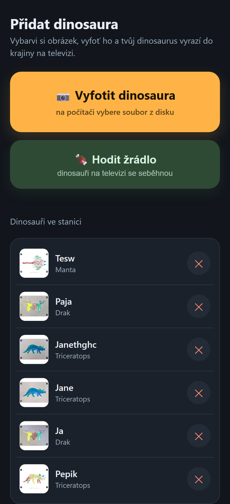

# DinoStanice

Domácí obdoba exponátu z Haus der Natur v Salzburgu: dítě vybarví předtištěnou
šablonu, vyfotí ji mobilem — a jeho tvor obživne na televizi: dinosaurus
v křídové laguně, ryba v akváriu.



Obrys šablony se z fotky nehádá: **předloha vzniká promítnutím hotového 3D
modelu na list**, takže kde na papíře leží bod, tam má na modelu svoje UV.
Vybarvená fotka sedne na kůži jednou transformací a drží ve všech pózách.



Druhá krajina je akvárium — sedm druhů ryb plave ve čtyřech hloubkách, uhýbá si
a chodí za krmením, které z mobilu padá na hladinu a klesá ke dnu.



Modely jsou natočené k divákovi, aby nebyly plochou kulisou. Kolik natočení
snese, je dané předlohou: čím víc se tvor otočí, tím víc čelní plochy ukáže —
a tam už kresba z listu není.



Vlevo přehled šablon k tisku, vpravo stránka pro mobil, na kterou vede QR kód
v rohu scény:

<p>
  
  
</p>

## Jak to spustit

Nejjednodušeji — dvojklik na **`DinoStanice.cmd`**. Doinstaluje si, co chybí,
vybere volný port, spustí server a otevře scénu v prohlížeči. Když na portu
8100 zjistí běžící kontejner téže stanice, nabídne otevřít ten místo startu
druhé instance nad týmiž úlovky. Konec: `Ctrl+C` v okně.

V Dockeru (běží pořád, přežije restart PC):

```powershell
docker compose up -d --build      # správa na http://localhost:8100/
docker compose logs -f            # co se děje
docker compose down               # konec
```

Port je **8100** (8000 na domácím stroji drží jiná služba). Přepíše se
proměnnou `DINO_PORT` (v `.env` nebo na příkazové řádce).
Úlovky (`data/catch/`), koš smazaných (`data/trash/`) i stanice a kód správce
(`data/config/`) jsou bind mountnuté ven, takže přestavbu image přežijí.

**Kód hlavního správce** je v `.env` jako `DINO_ADMIN_CODE=…`. Když tam není, server ho
při prvním startu vygeneruje, uloží do `data/config/admin.json` a vypíše do
logu (`docker compose logs | findstr kód`).

Nebo přímo z konzole, bez kontejneru:

```powershell
.\start.ps1                       # volitelně -Port 8123, -NoBrowser
```

Rozdíl proti Dockeru: běží jen dokud je okno otevřené a změny ve `web/` jsou
vidět po reloadu (v kontejneru je frontend zapečený v image, takže se musí
přestavět). Úlovky, koš a nastavení scény jsou v obou případech tytéž soubory
v `data/`.

Skript vypíše dvě adresy: **scénu** (otevři na PC vyvedeném do televize, klávesa
`F` přepne na celou obrazovku) a **stránku pro mobil**. V rohu scény svítí QR
kód, kterým se mobil připojí sám — první minutu a půl velký, pak se sám zmenší
a po delším klidu se jednou za čas připomene. Pod scénou je odkaz na
`/sablony` — přehled všech předloh s náhledy, tiskem a prokliky na 3D modely.

Klávesy ve scéně: `F` celá obrazovka, `H` ručně skryje/ukáže QR panel (a vypne
jeho automatiku), `I` lištu dole, `D` otevře ladicí panel s tempem a rychlostí
(viz níže).

Dole běží lišta: vlevo kolik je ve scéně kterého tvora, vpravo posledních pět
příchodů a odchodů (`+`/`−`, typ a jméno z odeslané fotky; u tvorů z katalogu
jméno není, tak je tam `-`).

## Na cizí počítač (balík bez Pythonu)

Když má stanice běžet tam, kde není Python ani Docker:

```powershell
powershell -File tools\build_exe.ps1
```

Vznikne `dist\DinoStanice\` s `DinoStanice.exe` a k přenosu
`dist\DinoStanice-win64.zip` (89 MB) — rozbalit kamkoli, dvojklik na
`DinoStanice.exe`. Okno vypíše tytéž adresy jako `start.ps1`, vybere volný port
a otevře scénu v prohlížeči (`--nobrowser`, `--port 8123` fungují stejně).

Je to složka, a ne jediný exe, přesto že jediný exe umí PyInstaller taky
(`tools\build_exe.ps1 -OneFile`, 89 MB): ten při **každém** startu rozbaluje
212 MB knihoven do `%TEMP%` — naměřeno 2,7 s do prvního načtení scény proti
1,1 s u složky, po hrubém ukončení nechá v temp 202 MB smetí a antivirus si ho
prochází pořád znovu. Jeden ZIP se přenáší stejně dobře jako jeden soubor.

**Úlovky, koš a nastavení scény vznikají v `data\` vedle exe** — přežijí
vypnutí a dají se zkopírovat jinam. Šablony, modely a frontend jsou naopak
zapečené v balíku, protože se jen čtou.

Co uživatel na cizím PC uvidí:

- **„Windows protected your PC"** (SmartScreen) — exe není podepsaný,
  certifikát nemáme. *Více informací* → *Přesto spustit*. Antivirus může
  udělat totéž a exe na chvíli zdržet.
- **Dotaz brány Windows firewall** — server poslouchá na `0.0.0.0`, aby na něj
  dosáhl mobil. Povolit v **privátních** sítích; bez toho scéna na tomtéž PC
  pojede, ale mobil se nepřipojí.

PyInstaller do `requirements.txt` nepatří (do běhu stanice není potřeba), sedí
v `requirements-dev.txt` — build script si ho doinstaluje sám.

## Co tvorové ve scéně dělají

Nový úlovek přichází **vždy zleva** a pár sekund nad ním visí jmenovka se
jménem z fotky, takže dítě ví, kam koukat a že je to ten jeho. Když má tvor
odejít (smazání, výměna za nový úlovek), neodpaří se — dojde, doletí nebo
dopluje za okraj vlastním tempem.

Chodci nejdou pořád dokola: každých 11–34 s se zastaví a 3–9 s postojí, občas
místo toho vyskočí a po stání se skoro v polovině případů otočí a jdou zpátky.
Když obejdou scénu dokola, vrací se druhým pásem — kdo šel vzadu za lagunou, jde
podruhé vepředu, takže se každý aspoň jednou ukáže zblízka.
Zastavení se plynule prolne do klidové pózy z katalogu, takže se nikdo nezasekne
v půlce kroku. Kromě toho se každý sune šikmo po pásu břehu, aby nešli všichni
po jedné lince.

Část chodců navíc dostane **trasu** — lomenou čáru zapsanou v definici scény,
se zastávkami a otočkami tam, kde je autor chce. Zbytek bloumá po pásech
postaru, ať má scéna obojí.

Z mobilu se dá **krmit**: tlačítko na stránce pro přidání shodí do scény trs
kapradí a chodci v okolí k němu zamíří, poží a jdou dál. Krmení má cooldown,
ať děti scénu nezasypou.

## Ladění chůze

Klávesa `D` ve scéně vytáhne panel, kde se dá u každého druhu za běhu měnit:

- **tempo** — tempo animace. Rychlost po scéně jde s ním, aby chodidla zůstala
  na zemi: tvor jen šlape rychleji a odpovídajícím dílem ujde víc.
- **rychlost** — násobek dopočítané rychlosti. Tímhle se sladění chodidel
  naopak rozladí; je to šroubek pro případ, že měřený krok sedí špatně.

Prázdné pole znamená automat (v šedém textu je vidět, co si scéna spočítala
sama). Automat míří na přirozené tempo druhu z katalogu (paleo odhady:
apatosaurus se plouží, velociraptor si vykračuje) a tvora posouvá po fázové křivce klipu,
takže prokluz chodidel drží kolem 1 % ujeté dráhy. Vpravo svítí, co z toho
vyšlo: rychlost v px/s, jak dlouho trvá přejezd obrazovky, délka cyklu
a naměřená délka kroku v délkách těla. Nastavení drží `localStorage`, takže
přežije reload, a tlačítko **kopírovat JSON** vysype hodnoty, které se dají
zapéct natrvalo.

Regresní kontrola chůze: `python tools/gait_report.py` osadí běžící scénu
chodci, chvíli měří a spadne, když prokluz nebo tempo vyjedou z mezí.

## Stanice, správci a děti

Hlavní stránka (`http://<adresa>:8100/`) je **správa**. Postup:

1. Přihlas se svým **kódem správce**.
2. **Založ stanici** (vybereš krajinu). Stanice = jedna televize se svou
   krajinou, svými zvířaty a QR kódem pro děti.
3. U stanice je **odkaz pro televizi** (`/tv/<tajný kód>`). Otevři ho
   v prohlížeči na počítači u televize (klávesa F = celá obrazovka). Kdo odkaz
   nemá, cizí scénu neotevře. Na televizi, kde se odkaz špatně píše, stačí
   otevřít `/tv` — ukáže čtyřmístný kód, který se zadá u stanice ve správě.
4. Děti naskenují **QR kód** (na televizi i k vytištění) a dostanou se jen
   na focení obrázku, házení žrádla, náhledy zvířat, která běžící krajina
   pustí, a svoje zvířata (smazat jde jen svoje — pozná se podle mobilu).
5. Ve správě stanice přepínáš krajinu, ukázková zvířata, „neusínat",
   mažeš zvířata od dětí, tiskneš předlohy (roztříděné podle krajin) a QR
   a nakonec stanici ukončíš.

**Víc správců na jednom serveru.** Hlavní správce (kód z `.env`) přidává ve
správě další správce — každý dostane vlastní kód a vidí jen svoje stanice,
hlavní správce všechny. Kód se ukáže jen při vytvoření; ztracený se nahradí
novým (starý přestane platit). Zrušený správce o stanice nepřijde — převezme
je hlavní.

Zvíře z jiné krajiny se **odmítne a neuloží** — dítě dostane hlášku, co
sem patří. Neznámá stanice se nezaloží: skončená stanice řekne „neběží".

Domácí stanice `tv` vznikla z dřívějšího nastavení a neusíná. Ostatní po
čtvrthodině bez aktivity **usnou** (lze vypnout přepínačem „Neusínat"): na TV
běží dvě minuty odpočet, pak scéna ztmavne a zbude velké QR. Probudí ji sken
QR, upload nebo krmení; nic se přitom nemaže. Staré odkazy `/admin`
a `/rezim` vedou na hlavní stránku.

Smazané úlovky (i jednotlivé, mazané ze stránky pro mobil) nekončí v nicotě,
ale v koši `data/trash/` — jsou to dětské výtvory a omylem stisknuté tlačítko
je nesmí zničit. Koš se čistí po 30 dnech.

## Jak vytisknout šablony

Ve správě stanice (nebo na `/sablony`) jsou předlohy roztříděné podle krajin;
„🖨 Tisk všech" pošle na tiskárnu celou krajinu, každou předlohu na vlastní
list A4 na šířku. Vyrobit znovu: `python tools/model_sheet.py`.

Tiskni **na 100 %**, žádné „přizpůsobit stránce" — na měřítku záleží, rozměry
v milimetrech drží celou pipeline pohromadě. Zmenšený list se pozná: rohové
značky přestanou sedět k sobě a server fotku odmítne s hláškou, že list není
rovně a celý.

## Jak fotit (měřeno, ne odhadnuto)

- **Zblízka** — list ať vyplní většinu záběru, bezpečně přes 30 % šířky.
  Pod ~20 % značky přestanou být čitelné. Tohle je druhý nejkřehčí článek.
- **Zaostřeno** — klepni na displej. Rozmazání je vůbec nejkřehčí místo celého
  řetězce.
- Na čem naopak **nezáleží**: náklon kamery, stíny, nerovnoměrné světlo,
  kvalita JPEG, otočení listu vzhůru nohama. To všechno pipeline zvládá.
- Všechny **čtyři černé čtverečky v rozích** ať jsou vidět. Se dvěma to ještě
  projde, s jedním pipeline schválně odmítne — z jediné značky vychází
  registrace až o desítky milimetrů vedle, a to potichu.

Když fotka neprojde, server neodpoví obecným „nepovedlo se", ale konkrétní
českou radou (rozmazané, moc daleko, zakryté značky, nevybarveno…). Odmítnuté
fotky se schovávají v `data/rejected/` — jsou to nejcennější testovací data.

## Jak to funguje

Obrys šablony se z fotky nehádá — **předloha vzniká promítnutím hotového 3D
modelu na list**. Tím je registrace zadarmo: kde na papíře leží bod, tam má na
modelu svoje UV, takže vybarvená fotka sedne na kůži jednou transformací
a drží ve všech pózách a úhlech. Hloubka se nedopočítává, protože model ji má
od autora — stejně jako kostru a chůzi.

```
model (GLB, CC0) → bokorys → šablona (SVG, tisk) → dítě vybarví → foto mobilem
  → POST /api/upload → detect_sheet()   (ArUco → homografie → srovnaný list)
  → capture3d.save_catch()              (barvy z papíru jako textura na kůži)
  → data/catch/<id>/ → WebSocket → scéna přidá tvora
```

Podrobnosti a kontrakty mezi částmi jsou v [ARCHITECTURE.md](ARCHITECTURE.md).

## Co je v katalogu

Patnáct šablon ve dvou krajinách. **Křídová laguna** (značky 8–15):
Tyrannosaurus, Velociraptor, Triceratops, Stegosaurus, Parasaurolophus
a Apatosaurus chodí po břehu, drak a ptakoještěr létají nad lagunou.
**Akvárium** (16–22): klaunská rybka, žralok, čtverzubec, mečoun, perutýn,
manta a axolotl. Scéna přijme jen tvory své krajiny — kdo patří jinam, počká
na přepnutí.

Modely jsou hotové rigované GLB (`data/models_src/*.glb`, většinou CC0 od
Quaternia; ptakoještěr a axolotl přišli bez kostry a pod CC-BY, tak ji mají
dopsanou — autoři a licence v [CREDITS.md](CREDITS.md)).

## Jak přidat scénu (a zvířata)

Scéna je složka `scenes/<klíč>/`: `scene.json` (jméno, popis, texty pro děti,
zvířata), `render.js` (krajina, světla, pásy, pohyb, krmení) a volitelně
`POZNAMKY.md` (proč má které zvíře výjimky).

```powershell
python tools/scena.py nova les --z cretaceous   # 1. složka podle vzorové scény
#   2. modely (glb/fbx/obj/blend, s kostrou a animacemi) do scenes/les/modely/
python tools/scena.py import les                # 3. Blender srovná, předlohy a modely se vygenerují
docker compose up -d --build                    # 4. nasadit
```

Import modely převede Blenderem (headless; cesta v `.env` jako `BLENDER=…`,
hotová GLB projdou i s `--bez-blenderu`), postaví je na zem, odhadne pohyb
(chůze/let/plavání) a role klipů, zkontroluje kostru, klipy a kost oka a vypíše,
co opravit ve `scene.json`. **Indexy značek přiděluje sám** do
`scenes/markers.json` — jen přibývají, nikdy se nerecyklují (index je
vytištěný v rozích listů). `python tools/scena.py kontrola les` jen zkontroluje
bez zápisu. Náhled předlohy je pak v `out/<zvíře>_sheet.png` — **prohlédnout**,
póza a oko se ladí ve `scene.json` (`poses`, `anim`/`time`, `eye_joint`,
`eye_bias`, `axes`/`flip`, `"import": {"rotate_y": 90}`) a import se pustí znovu.

Scéna, která má jen jinou krajinu se stejnými zvířaty (jako Noční laguna), má
ve `scene.json` jen `"catalogue": "<vlastník>"` a texty zdědí.

Póza předlohy se vybírá sama — projde se cyklus chůze a vezme se okamžik, kdy
tvar nejlíp vyplní list (rozkročené nohy jsou čitelnější a pro texturu
vydatnější). Dva tvorové mají pózu natvrdo, protože jejich poznávací znak je
čitelný jen v jedné: drak drží rozepjaté křídlo a axolotl rozevírá žaberní
vějíř. Oko se dokresluje, modely žádné nemají.

## Generátory předloh a modelů

```powershell
python tools/model_sheet.py            # předlohy: data/templates/*.svg
python tools/model_export3d.py         # modely pro prohlížeč + ukázkové textury
python tools/model_paint_demo.py       # kontrola bez tiskárny: snímky z úhlů
python tools/make_pteranodon.py        # ptakoještěr: kostra a let z holé geometrie
python tools/make_axolotl.py           # axolotl: kostra, plavání a póza předlohy
```

Létající tvor se kreslí **shora** a natočený tak, aby rozpětí křídel leželo po
šířce listu — z boku jsou křídla jen tenký profil, ze kterého není co vybarvovat.

Živě na `http://<adresa>:8100/dino3d` — výběr tvora i úlovku, všechny animace,
otáčení myší. Snímky bez televize: `python tools/shot3d.py --creature trex3d`.

### Na televizi

Vybarvený tvor se objeví rovnou ve scéně: chodí po břehu, létá nad lagunou.
Krajina zůstává malovaná do 2D plátna, tvorové se kreslí do průhledné WebGL
vrstvy nad ní a kapradí v popředí je zase nad nimi, takže dinosaurus stojí
v trávě a ne nad ní. Kamera je ortografická a nastavená v pixelech obrazovky,
takže obě vrstvy sedí bez dopočítávání perspektivy.

Scéna je **data**: pásy, chování, osvětlení a krajina žijí v definici
`scenes/<key>/render.js`, samotný `web/scene.js` je generický stroj nad ní.
Druhá krajina (noční laguna) je proto pár řádků navrch.

Než něco přinesou děti, scéna se doplní tvory z katalogu s ukázkovými texturami,
aby televize nesvítila naprázdno. Každý úlovek jednoho z nich vystřídá.

```powershell
python tools/shot_scene.py             # snímky scény bez televize (out/scena_*.png)
python tools/shot_scene.py --demo      # navíc doplní celý katalog
```

## Vývoj bez tiskárny

`dinostanice/modelsheet.rasterise()` nakreslí tentýž list, který jde do tiskárny,
`dinostanice/synth.py` ho vybarví pastelkami a vyfotí simulovaným mobilem
(perspektiva, osvětlení, rozostření, šum, JPEG). Celá pipeline se tak dá vyvíjet
a regresně testovat, aniž by kdokoli něco vytiskl:

```powershell
python -m pytest -q          # 179 testů
```

Součástí je `tests/test_server.py` (36 testů) — end-to-end přes FastAPI
TestClient: upload syntetické fotky, sessions, uspávání, mazání přes koš,
limity —, `tests/test_catalogue.py` (33 testů), který drží katalog a role klipů
v souladu s GLB, a `tests/test_robustness.py` (63 testů), který prosvěcuje
každou osu degradace fotky a drží naměřené hranice snímání pod kontrolou.
`out/robustness_report.md` shrnuje, kde přesně se snímání láme a proč.

## Struktura

| cesta | co to je |
|---|---|
| `dinostanice/` | pipeline: předloha z modelu, snímání, textura, kvalita, úložiště |
| `dinostanice/modelsheet.py` | z projekce modelu předloha k vybarvení + převod mm ↔ model |
| `dinostanice/creatures3d.py` | katalog tvorů: model, projekce, značka, vlastnosti pro scénu |
| `dinostanice/scenes.py` | registr scén (krajin) pro server |
| `data/models_src/` | stažené zdrojové modely (GLB) |
| `data/models3d/` | modely pro scénu a prohlížeč: GLB s UV, textury, katalog |
| `data/shapes3d/` | geometrie předloh (obrys, linky, oko, `Placement`) |
| `data/templates/` | vygenerované šablony (SVG k tisku), server je vydává na `/templates` |
| `web/` | scéna na TV, dětská stránka, admin, předlohy |
| `web/scene3d.js` | 3D tvorové ve scéně: ortokamera v pixelech, měřený krok |
| `scenes/<key>/` | scény: `scene.json` (texty, zvířata) + `render.js` (pásy, chování, světla) |
| `scenes/markers.json` | indexy značek zvířat — jen přibývají |
| `tools/scena.py` | nová scéna, import modelů přes Blender, kontrola |
| `web/backdrops/` | malované krajiny s variantami (den/noc) |
| `tools/model_sheet.py` | předlohy z modelů (SVG, náhled, geometrie) |
| `tools/gait_report.py` | regresní brána chůze: prokluz a tempo per druh |
| `tests/` | regresní sada nad syntetickými daty |
| `tests/test_server.py` | end-to-end testy serveru přes TestClient |
| `data/catch/` | úlovky — co děti nafotily |
| `data/trash/` | koš smazaných úlovků (30 dní) |
| `data/rejected/` | posledních 50 odmítnutých fotek (testovací data) |
| `data/config/` | stanice, správci (otisky kódů), tajný klíč a vygenerovaný kód hlavního správce |
| `data/state.json` | staré nastavení domácí TV — čte se jen při první migraci |
| `out/` | pracovní výstupy, náhledy, reporty |
| `DinoStanice.cmd` | spuštění dvojklikem (bez Dockeru) |
| `launcher.py` | vstupní bod balíku: adresy, volný port, prohlížeč |
| `dinostanice.spec` | recept pro PyInstaller (co se balí, co se skrývá) |
| `tools/build_exe.ps1` | jeden příkaz: balík + ZIP k přenesení |

## Licence

Kód a krajina jsou pod [MIT](LICENSE). 3D modely jsou cizí práce s vlastními
licencemi (většinou CC0, ptakoještěr a axolotl CC BY 4.0) — autoři, licence
a odkazy jsou v [CREDITS.md](CREDITS.md).
